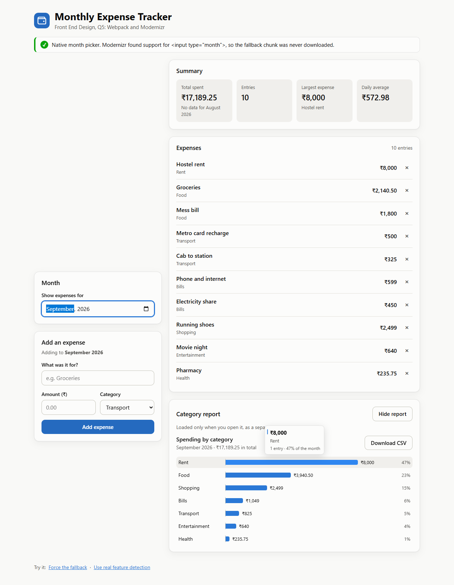
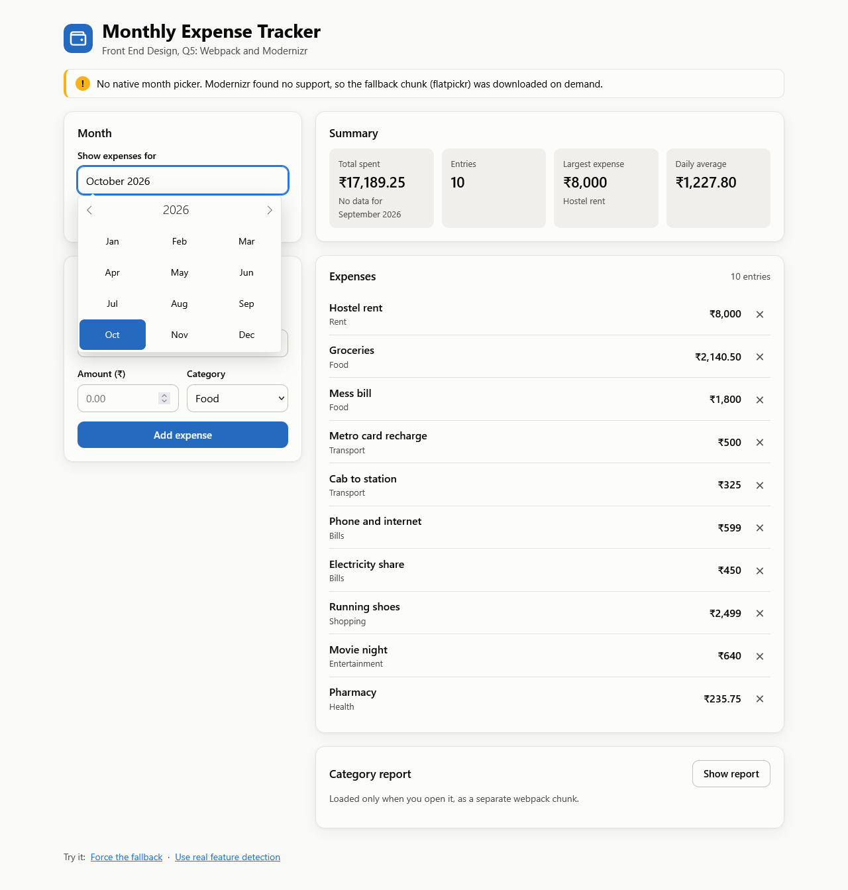
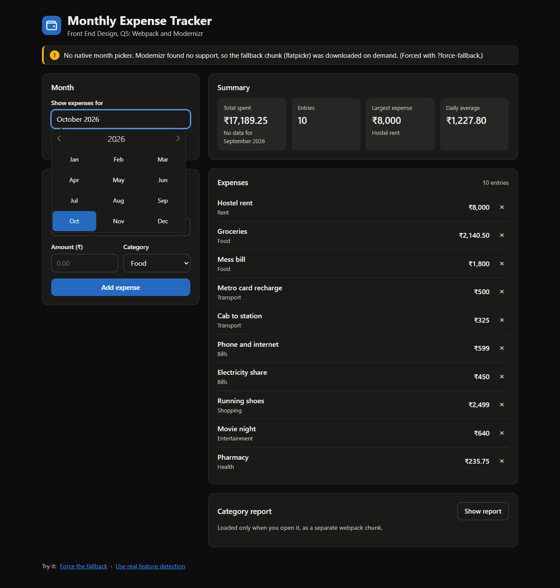
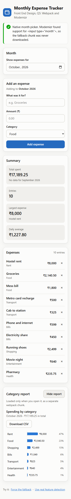

# Monthly Expense Tracker: Webpack code splitting + Modernizr feature detection


A small expense tracker built for **Front End Design, assignment Q5**. Modernizr detects whether
the browser supports `<input type="month">`. Browsers that do get the native picker. Browsers that
don't (desktop Firefox and Safari) download a fallback month picker as a separate webpack chunk,
so nobody downloads code they don't need.

| Chrome: native month picker | Firefox: fallback picker, loaded on demand |
|---|---|
|  |  |

> **Q5. Modernizr and Webpack.** Develop a small modular web application that uses Webpack for
> bundling, code splitting, and production optimization. Integrate Modernizr to detect support
> for a selected HTML5 or CSS3 feature, then implement and demonstrate an appropriate fallback
> for browsers that do not support it.

---

## Quick start

Needs **Node.js 22.15 or newer**.

```bash
git clone https://github.com/Aditya-XR/fde-q5-webpack-modernizr.git
cd fde-q5-webpack-modernizr
npm install
npm start          # dev server with hot reload: http://localhost:8080
```

| Command | What it does |
|---|---|
| `npm start` | Development server with hot reload |
| `npm run build` | Optimised production build into `dist/` |
| `npm run preview` | Serves `dist/` at http://localhost:5000 |
| `npm run analyze` | Production build + `bundle-report.html` (treemap of every chunk) |
| `npm run modernizr` | Optional: writes the custom Modernizr build to `modernizr-build.js` so you can inspect it |

---

## Highlights

- **Real feature detection:** `Modernizr.inputtypes.month`, using a custom 2.4 KB build inlined in `<head>`.
- **Three-layer fallback:** native picker → lazy-loaded flatpickr month picker → validated
  `YYYY-MM` text field if the fallback can't load.
- **Code splitting three ways:**
  - conditional `import()` for the fallback
  - on-demand + prefetched `import()` for the report
  - vendor and runtime chunks
- **Small first load:** about 20 KB (≈8 KB gzipped). Chrome and Edge never download the 74 KB fallback.
- **The app itself:**
  - add, delete and validate expenses
  - month summary with change vs last month
  - category report with CSV export
  - data kept in `localStorage`
  - light and dark themes; responsive down to 375 px

---

## The feature: `<input type="month">`

This input type was chosen because browser support is split today. That means the fallback
runs in a **real browser** rather than only being simulated:

| Browser | Native `type="month"` | What the app does |
|---|---|---|
| Chrome, Edge (desktop and Android) | Yes | Uses the native picker; the fallback is never downloaded |
| Firefox (desktop) | **No** | Downloads the fallback chunk and shows a flatpickr month picker |
| Safari (macOS) | **No** | Same fallback as Firefox |

*Source: MDN browser-compat-data 8.1.5, `html.elements.input.type_month`.*

---

## How each requirement is met

| Requirement | Implementation |
|---|---|
| **Modular app** | ES modules in `src/`: a store (state, persistence, subscriptions), one module per view, and a `features/` folder for detection and the fallback. `index.js` only wires them together. |
| **Bundling** | [`webpack.config.js`](webpack.config.js): entry `src/index.js`. CSS goes through `css-loader`, and the SVG logo is an asset module. `HtmlWebpackPlugin` generates `index.html` and injects bundles with `defer`. |
| **Code splitting** | 1. **Conditional:** `import()` of the month-picker fallback, only when Modernizr reports no support (never prefetched).<br>2. **On demand:** `import()` of the category report when first opened, prefetched while idle.<br>3. **Vendor split:** `splitChunks` puts flatpickr (from `node_modules`) in its own `vendors-month-fallback` chunk.<br>4. **Runtime chunk:** `runtimeChunk: 'single'`.<br>CSS is split per chunk too. |
| **Production optimisation** | Terser (JS) and `CssMinimizerPlugin` (CSS) minification. `MiniCssExtractPlugin` puts CSS in cacheable files. `[contenthash]` file names for long-term caching. Tree shaking with `"sideEffects": ["*.css"]`. Minified HTML. Small images inlined as data URIs. Source maps. Performance budgets. |
| **Modernizr** | A **custom build** with only the `inputtypes` test ([`modernizr-config.json`](modernizr-config.json)), generated by Modernizr's Node API inside `webpack.config.js` and **inlined in `<head>`**. It runs before first paint and before the deferred bundles. |
| **Fallback** | [`src/features/monthField.js`](src/features/monthField.js). Three layers, each producing the same `"YYYY-MM"` value:<br>1. native picker<br>2. flatpickr month picker, lazy-loaded<br>3. plain text field with `pattern` validation if that chunk fails to load |
| **Demonstration** | A status banner shows which path ran. `?force-fallback` forces the fallback in any browser. Modernizr's CSS class `.no-inputtypes-month` reveals a hint, so the detection drives CSS as well as JavaScript. |

---

## Measured build output

Output of `npm run build`:

| File | Size | gzip | Who downloads it |
|---|---:|---:|---|
| `index.html` (includes the 2.4 KB Modernizr build) | 5.4 KB | 2.4 KB | everyone |
| `js/runtime.[hash].js` | 5.2 KB | 2.4 KB | everyone |
| `js/main.[hash].js` | 8.4 KB | 3.5 KB | everyone |
| `css/main.[hash].css` | 6.4 KB | 2.3 KB | everyone |
| `js/report.[hash].js` + `css/report.[hash].css` | 3.0 + 1.9 KB | 1.5 + 0.9 KB | prefetched while idle, used when the report is opened |
| `js/month-fallback.[hash].js` | 0.5 KB | 0.4 KB | **only browsers without `type="month"`** |
| `js/vendors-month-fallback.[hash].js` (flatpickr) | 54.5 KB | 15.4 KB | **only browsers without `type="month"`** |
| `css/month-fallback.[hash].css` | 19.1 KB | 3.3 KB | **only browsers without `type="month"`** |

---

## How to demonstrate it

1. **Native path:** open the app in Chrome or Edge. The banner is green. In DevTools → Network → JS,
   only `runtime`, `main` and the prefetched `report` load.
2. **Real fallback:** open the same URL in Firefox (or Safari on a Mac). The banner is amber, and the
   Network tab shows `month-fallback`, `vendors-month-fallback` and `month-fallback.css` being fetched.
3. **No Firefox available?** Click **Force the fallback** in the footer (`?force-fallback`). The page
   runs the same code path as a browser without support.
4. **Third layer:** in DevTools → Network, right-click `month-fallback…js` → *Block request URL*, then
   reload with `?force-fallback`. The banner turns red and the field becomes a validated text box
   (type `2026-08`, press Tab).
5. **Bundle report:** run `npm run analyze`. The treemap shows flatpickr only inside the lazy
   `vendors-month-fallback` chunk.
6. **Caching:** change one CSS rule and rebuild. Only the CSS file name changes; `main.[hash].js`
   keeps its name, so browsers keep their cached copy.

---

## Project structure

```
modernizr-config.json        which Modernizr tests to include (only inputtypes)
webpack.config.js            bundling, splitting, optimisation, Modernizr inlining
src/
  index.html                 template; Modernizr is inlined in <head>
  index.js                   entry: wires modules together
  styles/main.css            design tokens, layout, light and dark themes
  assets/wallet.svg          logo (inlined by webpack) and favicon
  features/
    monthField.js            Modernizr check → native | fallback | plain text
    featureStatus.js         status banner for the demo
    fallback/
      monthPicker.js         LAZY CHUNK: flatpickr + monthSelect plugin
      monthPicker.css        flatpickr theme matching the app
  modules/
    store.js                 state, localStorage, subscribe(); amounts in paise
    format.js                currency / month helpers (Intl)
    expenseForm.js           validated form
    expenseList.js           list, delete, sample data
    summary.js               stat tiles (total, entries, largest, daily average)
    sampleData.js            demo data
    reportPanel.js           show/hide button + import() of the report
    report/
      categoryReport.js      LAZY CHUNK: bar breakdown, tooltip, CSV export
      categoryReport.css
docs/screenshots/            images used in this README
```

---

## Design decisions

- **Why detect features instead of checking the browser name?** User-agent sniffing guesses from
  a name and breaks when browsers change. Modernizr actually creates an `<input type="month">`
  and checks whether the browser treats it as one.
- **Why not CSS `@supports`?** It can only test CSS properties, not HTML input types. Modernizr's
  result is available to both JavaScript (`Modernizr.inputtypes.month`) and CSS
  (`.no-inputtypes-month`).
- **Why inline Modernizr in `<head>`?** The app bundles load with `defer`. Modernizr must have run
  before first paint (for the CSS class) and before the app decides what to load. At 2.4 KB,
  inlining is cheaper than an extra request.
- **Why a custom build through the Node API?** It includes one test instead of the whole library.
  The old webpack loaders for Modernizr are unmaintained.
- **Why is the report prefetched but the fallback is not?** Prefetching downloads a chunk in the
  background. That suits the report, which anyone may open. Prefetching the fallback would make
  Chrome download 74 KB it can never use.
- **Why not give the vendor chunk a fixed name?** A fixed `name` merges all `node_modules` code into
  one chunk. As soon as the main bundle uses any npm package, every page has to load that chunk.
  In a test build where it did, the first load grew from about 5 KB to 59 KB, because flatpickr
  was pulled in.
- **Why `"sideEffects": ["*.css"]` rather than `false`?** `false` would let webpack tree-shake the
  `import './styles.css'` lines away in production.
- **Money in paise (integers):** avoids floating-point rounding (`0.1 + 0.2`).
- **Safety:** user text is inserted with `textContent`, never `innerHTML`. CSV cells that start with
  `= + - @` are prefixed so spreadsheets don't run them as formulas.

---

## More screenshots

| `?force-fallback` in dark mode | Phone width (375 px) |
|---|---|
|  |  |

---

## Notes

- On recent npm versions, `npm init -y` adds `"type": "commonjs"` to `package.json`. Webpack then
  fails on every `import` with *"'import' and 'export' may appear only with 'sourceType: module'"*.
  This project's `package.json` deliberately has no `type` field.
- `npm audit` reports advisories in **development tools only**: webpack-dev-server's file watcher
  dependencies and the Markdown library Modernizr's build tool uses. None of that code ends up in
  `dist/`, which contains only the app and flatpickr.
